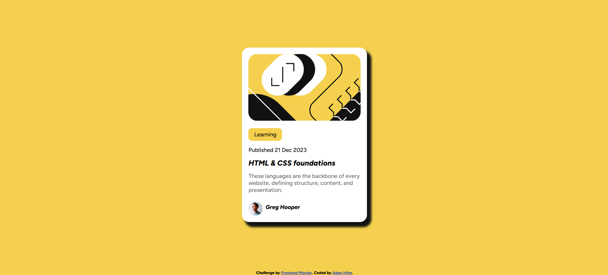

# Frontend Mentor - Blog Preview Card Solution

This is my solution to the [Blog Preview Card challenge on Frontend Mentor](https://www.frontendmentor.io/challenges/blog-preview-card-ckPaj01IcS). Frontend Mentor challenges help me improve my frontend development skills by building realistic projects based on design references.

## Table of Contents

- [Overview](#overview)
  - [The Challenge](#the-challenge)
  - [Screenshot](#screenshot)
  - [Links](#links)
- [My Process](#my-process)
  - [Built With](#built-with)
  - [What I Learned](#what-i-learned)
  - [Continued Development](#continued-development)
  - [Useful Resources](#useful-resources)
  - [AI Collaboration](#ai-collaboration)
- [Author](#author)
- [Acknowledgments](#acknowledgments)

## Overview

### The Challenge

The goal was to build a blog preview card that matches the provided design as closely as possible.

Users should be able to:

- View a blog preview card containing an article illustration, category, publication date, title, description, and author information.
- See a clean, centered layout with consistent spacing and padding.
- Read the content with clear typography and visual hierarchy.
- View the page on different screen sizes.

### Screenshot



### Links

- Solution URL: [Frontend Mentor Blog Preview Card Challenge](https://www.frontendmentor.io/challenges/blog-preview-card-ckPaj01IcS)
- Live Site URL: [https://blogpreviewcard201.netlify.app](https://blogpreviewcard201.netlify.app)

## My Process

### Built With

- Semantic HTML5
- CSS Flexbox
- Custom fonts using `@font-face`
- CSS colors using HSL values
- CSS spacing, padding, margins, and border radius
- Box shadows
- Responsive viewport configuration

### What I Learned

While working on this project, I practised centering a card using Flexbox, styling images, working with custom fonts, and improving spacing and typography.

One important concept I learned was how to center the card horizontally and vertically while allowing the main section to occupy the available space.

```css
.main-container {
  flex: 1;
  display: flex;
  justify-content: center;
  align-items: center;
}
```

The `flex: 1` property allows the main container to grow and fill the available space. The `justify-content` and `align-items` properties center the card along the main and cross axes.

I also learned how to load variable font files using `@font-face` so that the browser can use the correct font weight and style.

```css
@font-face {
  font-family: "Figtree";
  src: url("assets/fonts/Figtree-VariableFont_wght.ttf") format("truetype");
  font-weight: 300 900;
  font-style: normal;
}

@font-face {
  font-family: "Figtree";
  src: url("assets/fonts/Figtree-Italic-VariableFont_wght.ttf")
    format("truetype");
  font-weight: 300 900;
  font-style: italic;
}
```

This helped me understand how custom fonts improve the appearance and consistency of a webpage.

### Continued Development

In future projects, I want to focus on:

- Building responsive layouts for mobile, tablet, and desktop screens.
- Improving consistency in spacing, padding, and typography.
- Writing cleaner and more maintainable CSS.
- Using CSS custom properties for reusable colors and spacing values.
- Improving semantic HTML and accessibility.
- Comparing my solutions more carefully with the original designs.

### Useful Resources

- [MDN Web Docs - CSS Flexbox](https://developer.mozilla.org/en-US/docs/Web/CSS/CSS_flexible_box_layout) - Helped me understand how to align and center elements.
- [MDN Web Docs - `@font-face`](https://developer.mozilla.org/en-US/docs/Web/CSS/@font-face) - Helped me learn how to load custom font files.
- [MDN Web Docs - CSS Box Model](https://developer.mozilla.org/en-US/docs/Web/CSS/CSS_box_model) - Explained how padding, margins, borders, and content affect layout.
- [The Markdown Guide](https://www.markdownguide.org/) - Useful for writing and formatting this README.

## AI Collaboration

I used ChatGPT as a learning assistant during my frontend development journey.

I used AI to:

- Understand code review feedback and identify areas for improvement.
- Learn about CSS spacing, padding, typography, and best practices.
- Correct the font-family and font-style declarations for the Figtree variable font files.
- Improve the structure and clarity of my project documentation.

The most useful part was learning why certain changes improve code quality rather than simply copying suggested solutions. I aim to understand the recommendations, apply them myself, and test the results.

## Author

- GitHub: [Adan Irfan](https://github.com/AdanIrfan)
- Frontend Mentor: [Find me on Frontend Mentor](https://www.frontendmentor.io/)

## Acknowledgments

Thanks to [Frontend Mentor](https://www.frontendmentor.io/) for providing this challenge and its design resources, which helped me practise HTML and CSS through a practical project.

Thanks to the frontend development community and ChatGPT for providing guidance that supports my continued learning.
