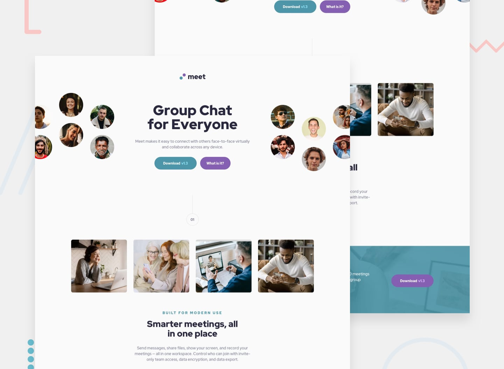

# Frontend Mentor - Meet landing page solution

This is a solution to the [Meet landing page challenge on Frontend Mentor](https://www.frontendmentor.io/challenges/meet-landing-page-rbTDS6OUR). Frontend Mentor challenges help you improve your coding skills by building realistic projects.

## Table of contents

- [Overview](#overview)
  - [The challenge](#the-challenge)
  - [Screenshot](#screenshot)
  - [Links](#links)
- [My process](#my-process)
  - [Built with](#built-with)
  - [What I learned](#what-i-learned)
  - [Continued development](#continued-development)
  - [Useful resources](#useful-resources)
- [Author](#author)
- [Acknowledgments](#acknowledgments)

## Overview

### The challenge

Users should be able to:

- View the optimal layout depending on their device's screen size.
- See hover states for interactive elements.
- Experience a responsive landing page across mobile, tablet, and desktop screen sizes.

### Screenshot

### Links

- Solution URL: [GitHub Repository](https://github.com/AdanIrfan/frontend-mentor-challenges/tree/main/newbie/meet-landing-page)
- Live Site URL: [Meet landing page](https://meetlandingpage201.netlify.app/)

## My process

### Built with

- Semantic HTML5 markup
- CSS custom properties
- Flexbox
- CSS Grid
- Responsive images and media queries
- Mobile-first responsive design principles

### What I learned

While building this project, I practiced creating responsive layouts and adapting page elements to different screen sizes.

Some of the key concepts I worked on include:

- Using CSS Flexbox and Grid to structure page layouts.
- Using media queries to adjust layouts for mobile, tablet, and desktop screens.
- Working with background images and `background-blend-mode` to create visual effects.
- Controlling element sizing with Flexbox properties such as `flex-basis`, `flex-grow`, and `flex-shrink`.
- Improving layout spacing, typography, and visual consistency across different screen sizes.

This project helped me understand how different CSS properties work together to create a responsive and visually appealing landing page.

### Continued development

In future projects, I want to continue improving my understanding of:

- Responsive design and mobile-first workflows.
- CSS Grid and Flexbox layout techniques.
- Responsive image handling and image positioning.
- Consistent spacing and typography based on design specifications.
- HTML accessibility and semantic markup.

### Useful resources

- [MDN Web Docs - CSS Flexbox](https://developer.mozilla.org/en-US/docs/Web/CSS/CSS_flexible_box_layout) - Helped me understand how to arrange and size elements using Flexbox.
- [MDN Web Docs - CSS Grid](https://developer.mozilla.org/en-US/docs/Web/CSS/CSS_grid_layout) - A useful reference for building grid-based layouts.
- [MDN Web Docs - Using Media Queries](https://developer.mozilla.org/en-US/docs/Web/CSS/CSS_media_queries/Using_media_queries) - Helped me understand how to apply styles based on screen size.
- [Frontend Mentor](https://www.frontendmentor.io/) - Provided the design challenge and an opportunity to practice front-end development.

## Author

- GitHub - [@AdanIrfan](https://github.com/AdanIrfan)
- Frontend Mentor - [@AdanIrfan](https://www.frontendmentor.io/profile/AdanIrfan)

## Acknowledgments

Thanks to Frontend Mentor for providing the design challenge and helping developers practice their front-end development skills through real-world projects.
