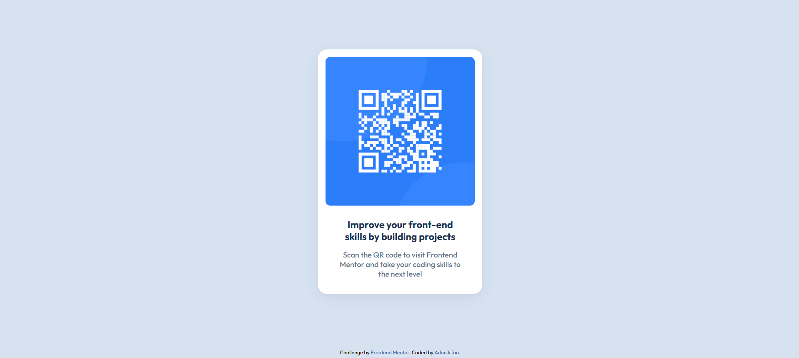

# Frontend Mentor - QR Code Component Solution

This is my solution to the [QR Code Component challenge on Frontend Mentor](https://www.frontendmentor.io/challenges/qr-code-component-iux_sIO_H). The goal of this challenge was to build a clean, responsive QR code card that closely matches the provided design using HTML and CSS.

## Table of Contents

- [Overview](#overview)
  - [Screenshot](#screenshot)
  - [Links](#links)
- [My Process](#my-process)
  - [Built With](#built-with)
  - [What I Learned](#what-i-learned)
  - [Continued Development](#continued-development)
  - [Useful Resources](#useful-resources)
  - [AI Collaboration](#ai-collaboration)
- [Author](#author)
- [Acknowledgments](#acknowledgments)

## Overview

### Screenshot

### Links

- Solution URL: [GitHub Repository](https://github.com/AdanIrfan/frontend-mentor-challenges/tree/main/newbie/qr-code-component)
- Live Site URL: [View Live Project](https://qrcodecomponent201.netlify.app/)

## My Process

### Built With

- Semantic HTML5 markup
- CSS3
- CSS custom properties
- Flexbox
- Responsive design principles
- Google Fonts
- Netlify for deployment

### What I Learned

This challenge helped me strengthen my understanding of HTML and CSS by building a component from a provided design.

I practiced structuring a page with semantic HTML, centering a card using CSS, and adjusting spacing, typography, and colors to match the original design as closely as possible.

I also gained experience deploying a static website with Netlify and connecting a GitHub repository to a live website.

### Continued Development

I want to continue improving my CSS layout skills, especially responsive design, spacing, typography, and accessibility.

I also plan to work on more Frontend Mentor challenges to become more confident translating design mockups into responsive, polished websites while writing clean and maintainable code.

### Useful Resources

- [Frontend Mentor - QR Code Component Challenge](https://www.frontendmentor.io/challenges/qr-code-component-iux_sIO_H) - The challenge that inspired this project.
- [MDN - CSS Flexbox](https://developer.mozilla.org/en-US/docs/Learn_web_development/Core/CSS_layout/Flexbox) - A useful guide to understanding Flexbox layouts.
- [Google Fonts](https://fonts.google.com/) - For exploring and using web fonts.
- [Netlify Documentation](https://docs.netlify.com/) - For learning about deployment and hosting static websites.

### AI Collaboration

I used ChatGPT as a learning assistant during this project, particularly when troubleshooting deployment configuration and understanding how to publish a static website using Netlify.

This helped me become more familiar with the deployment workflow and the importance of configuring project directories correctly.

## Author

- GitHub - [@AdanIrfan](https://github.com/AdanIrfan)
- Frontend Mentor - [@AdanIrfan](https://www.frontendmentor.io/profile/AdanIrfan)

## Acknowledgments

Thanks to [Frontend Mentor](https://www.frontendmentor.io/) for providing the challenge and design resources. This project was a valuable opportunity to practice my HTML and CSS skills, learn about deployment, and take another step forward in my frontend development journey.
