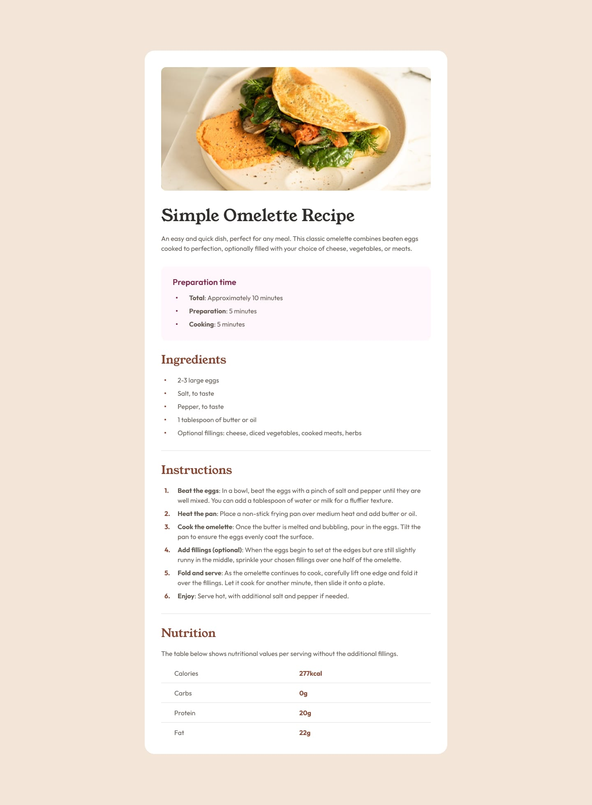

# Frontend Mentor - Recipe Page Solution

This is my solution to the [Recipe Page challenge on Frontend Mentor](https://www.frontendmentor.io/challenges/recipe-page-KiTsR8QQKm). Frontend Mentor challenges help improve coding skills by building realistic projects.

## Table of Contents

- [Overview](#overview)
  - [The Challenge](#the-challenge)
  - [Screenshot](#screenshot)
  - [Links](#links)
- [My Process](#my-process)
  - [Built With](#built-with)
  - [What I Learned](#what-i-learned)
  - [Continued Development](#continued-development)
  - [Useful Resources](#useful-resources)
  - [AI Collaboration](#ai-collaboration)
- [Author](#author)
- [Acknowledgments](#acknowledgments)

## Overview

### The Challenge

The goal of this challenge was to build a recipe page that closely matches the provided design while ensuring the page is responsive and accessible.

The page includes recipe information, preparation time, ingredients, instructions, and nutritional information.

### Screenshot

<!-- Add your screenshot here -->

### Links

- **Solution URL:** [View the project on GitHub](https://github.com/AdanIrfan/frontend-mentor-challenges/tree/main/newbie/recipe-page)
- **Live Site URL:** [View the live website](https://recipepage201.netlify.app/)

## My Process

### Built With

- Semantic HTML5 markup
- CSS custom properties
- Flexbox
- Responsive web design
- Mobile-first workflow

### What I Learned

Through this project, I practiced structuring a webpage using semantic HTML and styling it with CSS. I also worked on spacing, typography, layout, and responsive design to make the page look good across different screen sizes.

One important takeaway was learning how to organize CSS styles and use consistent spacing and font sizes to create a clean and readable layout.

### Continued Development

In future projects, I want to focus on:

- Improving responsive design for different screen sizes.
- Writing cleaner and more maintainable CSS.
- Using relative units such as `rem` for scalable typography.
- Improving semantic HTML and accessibility.
- Matching reference designs more accurately through better spacing and alignment.

### Useful Resources

- [MDN Web Docs](https://developer.mozilla.org/en-US/) — A useful reference for HTML, CSS, and responsive web design.
- [The Odin Project](https://www.theodinproject.com/) — Helped me develop my understanding of frontend development fundamentals.
- [Frontend Mentor](https://www.frontendmentor.io/) — Provided the challenge design and an opportunity to practice building a realistic webpage.

### AI Collaboration

I used ChatGPT to help clarify frontend development concepts and improve my understanding of HTML and CSS.

- **Tool used:** ChatGPT
- **Purpose:** Understanding concepts, troubleshooting issues, and getting guidance on responsive design and code improvements.
- **What worked well:** Breaking down unfamiliar concepts into simpler explanations helped me understand the reasoning behind different implementation choices.

The final implementation and project decisions were reviewed as part of my learning process.

## Author

- GitHub: [@AdanIrfan](https://github.com/AdanIrfan)
- Frontend Mentor: [@AdanIrfan](https://www.frontendmentor.io/profile/AdanIrfan)

## Acknowledgments

Thanks to [Frontend Mentor](https://www.frontendmentor.io/) for providing the challenge and design resources to practice and improve my frontend development skills.
