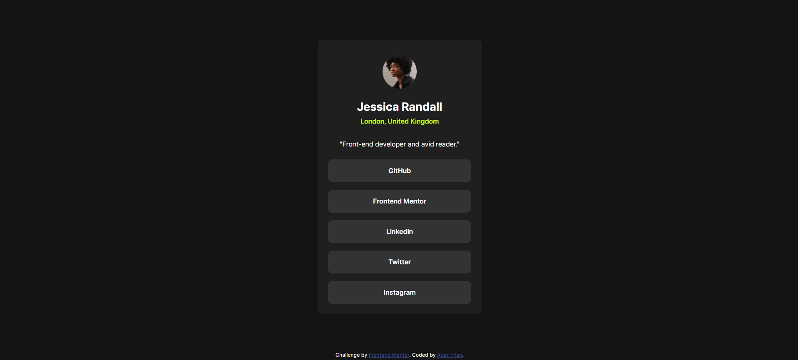

# Frontend Mentor - Social Links Profile Solution

This is my solution to the [Social Links Profile challenge on Frontend Mentor](https://www.frontendmentor.io/challenges/social-links-profile-UG32l9m6dQ). Frontend Mentor challenges help improve frontend development skills by building realistic projects.

## Table of Contents

- [Overview](#overview)
  - [The Challenge](#the-challenge)
  - [Screenshot](#screenshot)
  - [Links](#links)
- [My Process](#my-process)
  - [Built With](#built-with)
  - [What I Learned](#what-i-learned)
  - [Continued Development](#continued-development)
  - [Useful Resources](#useful-resources)
  - [AI Collaboration](#ai-collaboration)
- [Author](#author)
- [Acknowledgments](#acknowledgments)

## Overview

### The Challenge

Users should be able to:

- View a profile with a person's name, location, and description.
- See a list of social links.
- See hover and focus states for interactive elements.
- View a responsive layout on different screen sizes.

### Screenshot



> Replace `screenshot.jpg` with the filename of your actual screenshot, or update the path if your screenshot is stored elsewhere.

### Links

- **Solution URL:** [Add your Frontend Mentor solution URL here](https://www.frontendmentor.io/)
- **Live Site URL:** Add your deployed website URL here.

## My Process

### Built With

- Semantic HTML5
- CSS custom properties
- CSS Flexbox
- Responsive web design
- Custom fonts using `@font-face`
- Mobile-first development principles

### What I Learned

While building this project, I practiced structuring a profile card with HTML and styling it with CSS. I also learned how Flexbox can help center content and position a footer at the bottom of the page.

I practiced using CSS selectors to style profile information, social links, and interactive elements.

For example, Flexbox can help center the profile card:

```css
main {
  flex: 1;
  display: flex;
  justify-content: center;
  align-items: center;
}
```

I also learned how to create interactive hover effects for social links:

```css
ul li a {
  display: block;
  text-decoration: none;
  color: inherit;
}

ul li:hover {
  background-color: hsl(75, 94%, 57%);
  color: hsl(0, 0%, 8%);
}
```

### Continued Development

In future projects, I want to continue improving my skills in:

- Responsive layouts and mobile-first development.
- Flexbox and CSS Grid.
- Accessible HTML and keyboard navigation.
- Hover and focus states for interactive elements.
- Writing clean, reusable, and maintainable CSS.

### Useful Resources

- [MDN Web Docs - HTML](https://developer.mozilla.org/en-US/docs/Web/HTML) — A helpful reference for writing semantic HTML.
- [MDN Web Docs - CSS](https://developer.mozilla.org/en-US/docs/Web/CSS) — Useful for learning CSS properties, selectors, and layouts.
- [MDN Web Docs - Flexbox](https://developer.mozilla.org/en-US/docs/Web/CSS/CSS_flexible_box_layout) — Helped me understand how to align and position elements.
- [The Markdown Guide](https://www.markdownguide.org/) — Useful for formatting this README.

### AI Collaboration

I used ChatGPT as a learning assistant during development. It helped me understand HTML and CSS concepts, troubleshoot layout issues, improve code structure, and prepare this README.

I reviewed the suggestions and used them to support my understanding of the code.

## Author

- GitHub: [@AdanIrfan](https://github.com/AdanIrfan)
- Frontend Mentor: [Frontend Mentor Profile](https://www.frontendmentor.io/)

## Acknowledgments

Thanks to [Frontend Mentor](https://www.frontendmentor.io/) for providing the challenge and design resources to practice frontend development.
