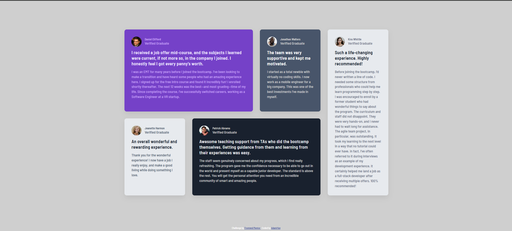

# Frontend Mentor - Testimonials grid section solution

This is a solution to the [Testimonials grid section challenge on Frontend Mentor](https://www.frontendmentor.io/challenges/testimonials-grid-section-Nnw6J7Un7).

Frontend Mentor challenges help improve coding skills by building realistic projects.

## Table of contents

- [Overview](#overview)
  - [The challenge](#the-challenge)
  - [Screenshot](#screenshot)
  - [Links](#links)
- [My process](#my-process)
  - [Built with](#built-with)
  - [What I learned](#what-i-learned)
  - [Continued development](#continued-development)
  - [Useful resources](#useful-resources)
  - [AI Collaboration](#ai-collaboration)
- [Author](#author)
- [Acknowledgments](#acknowledgments)

## Overview

### The challenge

Users should be able to:

- View the optimal layout for the site depending on their device's screen size
- View the testimonial cards arranged correctly on desktop and mobile screens
- Read the testimonial content with clear typography and spacing

### Screenshot



### Links

- Solution URL: [GitHub Repository](https://github.com/AdanIrfan/frontend-mentor-challenges/tree/main/newbie/testimonials-grid-section)
- Live Site URL: [Testimonials Grid Section](https://testimonialgraduates201.netlify.app/)

## My process

### Built with

- Semantic HTML5 markup
- CSS custom properties
- CSS Grid
- Flexbox
- `@font-face` for local fonts
- Mobile-first workflow
- Responsive design with media queries

### What I learned

This project helped me improve my understanding of CSS Grid, responsive layouts, semantic HTML, and typography.

#### 1. Creating a complex layout with CSS Grid

One of the main things I practiced was using CSS Grid to create the desktop layout.

I used multiple columns and positioned the testimonial cards using `grid-column` and `grid-row`.

````css
.container {
  display: grid;
  grid-template-columns: 1fr 1fr 1fr 1fr;
}

.card--daniel {
  grid-row: 1;
  grid-column: 1 / 3;
}

.card--jonathan {
  grid-row: 1;
  grid-column: 3;
}

.card--jeanette {
  grid-row: 2;
  grid-column: 1;
}

.card--patrick {
  grid-row: 2;
  grid-column: 2 / 4;
}

.card--kira {
  grid-row: 1 / 3;
  grid-column: 4;
}

This helped me understand how grid items can span multiple columns and rows instead of simply being placed one after another.
2. Using a mobile-first layout
I started with a single-column layout for smaller screens:
.container {
  display: grid;
  grid-template-columns: 1fr;
}

Then I changed the layout for larger screens using a media query:
@media (min-width: 700px) {
  .container {
    grid-template-columns: 1fr 1fr 1fr 1fr;
  }
}

This helped me understand the idea of starting with a simple layout and progressively adding complexity for larger screens.
3. Using CSS custom properties
I used CSS custom properties to store the colors from the design:
:root {
  --White: hsl(0, 0%, 100%);
  --Grey100: hsl(214, 17%, 92%);
  --Grey200: hsl(0, 0%, 81%);
  --Grey400: hsl(224, 10%, 45%);
  --Grey500: hsl(217, 19%, 35%);
  --Darkblue: hsl(219, 29%, 14%);

  --Purple50: hsl(260, 100%, 95%);
  --Purple300: hsl(264, 82%, 80%);
  --Purple500: hsl(263, 55%, 52%);
}

This made the stylesheet easier to maintain and allowed me to reuse the same colors throughout the project.
4. Working with local fonts
I also learned how to load the provided font files using @font-face:
@font-face {
  font-family: Barlow;
  src: url("./fonts/BarlowSemiCondensed-Medium.ttf") format("truetype");
  font-weight: 500;
}

@font-face {
  font-family: Barlow;
  src: url("./fonts/BarlowSemiCondensed-SemiBold.ttf") format("truetype");
  font-weight: 600;
}

This helped me understand how typography affects the overall appearance and spacing of a design.
Continued development
In future projects, I want to continue improving my understanding of responsive design and CSS layout.

In particular, I want to focus on:
- Improving responsive layouts across more viewport sizes
- Becoming more comfortable with CSS Grid
- Improving control over typography, especially font-size and line-height
- Understanding how spacing, padding, and margins affect responsive layouts
- Improving accessibility and semantic HTML
- Writing cleaner and more maintainable CSS
- Becoming better at comparing my implementation with the reference design and identifying small visual differences
Useful resources
- Frontend Mentor - The platform used for this challenge and for practicing frontend development.
- MDN CSS Grid - Helped me understand CSS Grid concepts and grid item placement.
- MDN Flexbox - Useful for understanding the flex layouts used inside the testimonial cards.
- MDN @font-face - Helped me understand how to use the provided local fonts.
AI Collaboration
I used ChatGPT as a learning and review assistant during this project.

I mainly used AI to:
- Review my HTML and CSS
- Explain CSS Grid and responsive design concepts
- Help identify potential accessibility improvements
- Discuss different approaches to structuring CSS
- Review spacing, typography, and layout decisions
- Understand why certain CSS approaches were better than others
I used the feedback as guidance rather than directly copying a complete solution. The project structure and implementation were written and tested by me.
Author
- GitHub - @AdanIrfan
- Frontend Mentor - @AdanIrfan
Acknowledgments
Thanks to Frontend Mentor for providing the challenge and design.

I also used MDN Web Docs as a reference while working with CSS Grid, Flexbox, responsive design, and semantic HTML.

### One important thing before you paste it

Your screenshot currently needs to actually exist at:

```text
testimonials-grid-section/
├── README.md
├── screenshot.jpg
├── index.html
├── styles.css
├── images/
└── fonts/
````
